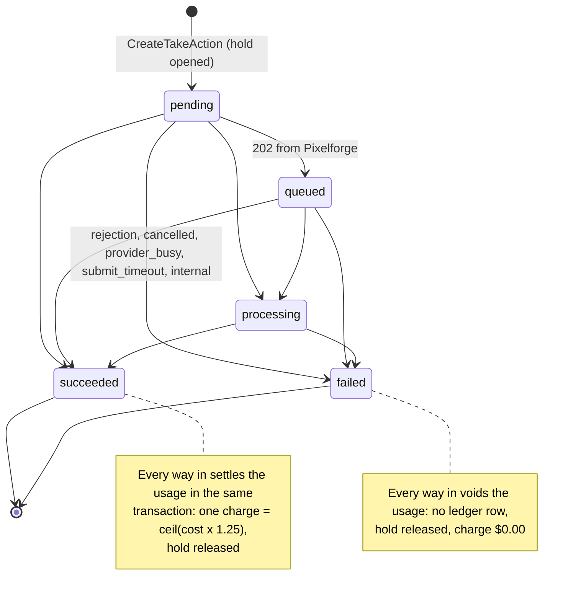

# Takes

[](https://github.com/JVillator0/takes/actions/workflows/ci.yml)

**Takes** is an image-generation studio built on the Pixelforge API for the PromptEdit take-home ([brief](https://pixelforge.promptedit.dev/assessment)). The role's mission is to *"create the most intuitive video editing tool UIs in the world"*, so Takes borrows the vocabulary of video editing: every generation is a **take**, takes live in **projects**, any take can be **remixed**, and **Describe a change** turns a sentence ("warmer, portrait") into a reviewed parameter diff with a new price. Customers pay the provider's cost plus 25% from prepaid (simulated) credits. Every provider call, Pixelforge images and Anthropic suggestions alike, goes through one ledger in integer nanodollars, so each charge is exact, recorded once and explainable.

Live app: **https://takes-production-aodrsk.laravel.cloud** · [Admin console](#admin-console): `/admin`, auditor login in the submission form · Plan and execution: [GitHub Project](https://github.com/users/JVillator0/projects/4) · Specs: [`.claude/specs/`](.claude/specs/README.md) · Decisions: [`DECISIONS.md`](.claude/specs/DECISIONS.md)

## Brief coverage

Every requirement, tip and stretch goal of the brief, plus what was added. Paths are relative to the repo root. **Redeploy evidence** marks a row that depends on specs 6 to 8, which were deployed after the required first deploy (D-063).

| Requirement | Tier | How to see it live | Code path | Pest test |
|---|---|---|---|---|
| Prompt form with size, quality and optional reference image URLs | required | Open a project; the composer sits under the grid | `resources/js/components/takes/TakeComposer.vue`, `app/Http/Requests/Takes/StoreTakeRequest.php`, `app/Actions/Takes/CreateTakeAction.php` | `tests/Feature/Takes/CreateTakeIdempotencyTest.php` |
| Cost shown before submitting | required | The button reads "Generate take · up to $x"; the estimate panel shows the range | `app/Support/Pricing/TakeEstimator.php`, `app/Queries/Takes/GetTakeEstimateQuery.php`, `app/Http/Controllers/Takes/EstimateController.php` | `tests/Unit/Pricing/TakeEstimatorTest.php` (docs worked example), `tests/Feature/Takes/EstimateEndpointTest.php` |
| Customer pays cost + 25% | required | Take drawer shows the exact charge; `/admin` › Studio › Takes › a take shows provider cost and charge (cost × 1.25); `/admin` › Billing › Reports shows the 20.0% margin | `app/Support/Money/Nanodollars.php` (`withMarkup`), `app/Actions/Billing/SettleUsageAction.php` | `tests/Unit/Billing/ChargeExactnessTest.php`, `tests/Feature/Billing/UsageActionsTest.php` |
| Exact actual cost recorded after completion | required | Drawer of a done take: "Charged $0.0740375"-style exact amount | `app/Actions/Takes/ApplyTakeSnapshotAction.php` -> `SettleUsageAction`, `app/Support/Money/TokenCost.php` (units × the generation's own rates) | `tests/Feature/Takes/ApplyTakeSnapshotActionTest.php`, `tests/Feature/Takes/TakeMoneyFlowTest.php` |
| Failed generations are free | required | Add `[fail]` to a prompt: "Failed", "You were not charged.", balance back where it was | `ApplyTakeSnapshotAction` / `app/Actions/Takes/FailTakeAction.php` -> `app/Actions/Billing/VoidUsageAction.php` | `tests/Feature/Takes/FailTakeActionTest.php`, `tests/Feature/Webhooks/WebhookOutcomeMatrixTest.php`, `TakeMoneyFlowTest` "is free when the generation fails" |
| Fractional cents | required | Lists show 4 decimals, money pages the exact amount | `app/Support/Money/Nanodollars.php` (`format`, `formatExact`, integer only) | `tests/Unit/Money/NanodollarsTest.php`, `tests/Arch/ArchitectureTest.php` (no floats in money code) |
| Live history: status, estimated and actual cost, image | required | Generate and watch the card move Queued -> Processing -> Done without reloading | `app/Events/TakeUpdated.php`, `resources/js/composables/useTakeUpdates.ts`, `resources/js/pages/projects/Show.vue` | `tests/Feature/Webhooks/TakeUpdatedBroadcastTest.php`, `tests/Feature/Projects/WorkspacePagesTest.php` |
| Webhook signatures verified | required | `curl -i -X POST https://takes-production-aodrsk.laravel.cloud/webhooks/pixelforge -d '{}'` answers 401 and writes nothing | `app/Http/Middleware/VerifyPixelforgeSignature.php`, `app/Support/Pixelforge/WebhookSignature.php` | `tests/Feature/Webhooks/PixelforgeSignatureTest.php` |
| Duplicate events never recorded twice | required | Showcase take `[duplicate] [succeed]`: one charge; `/admin` › Providers › Webhook deliveries shows the `duplicate` rows | `app/Actions/Webhooks/HandlePixelforgeWebhookAction.php`, unique `webhook_events.event_id` | `tests/Feature/Webhooks/WebhookIdempotencyTest.php`, `tests/Committed/TakeTransitionConcurrencyTest.php` |
| Correct state despite out-of-order events | required | The outcome matrix: a late `processing` after `succeeded` is `ignored_stale` and changes nothing (the showcase data has no out-of-order delivery to show) | `app/Actions/Takes/ApplyTakeSnapshotAction.php` (outcome matrix) | `tests/Feature/Takes/ApplyTakeSnapshotActionTest.php`, `WebhookOutcomeMatrixTest` |
| Rate limits, concurrency, overloads, failures after acceptance | required | `[overloaded]`: "Waiting for capacity", then it runs, or fails free as `provider_busy` after 30 min; Cancel works while waiting. A fourth take at once also shows "Waiting for capacity" ("We allow 3 at a time. Yours starts when one finishes.", with Cancel) until a slot frees | `app/Jobs/SubmitTakeJob.php`, `app/Support/Pixelforge/SubmitGate.php`, `app/Services/Pixelforge/PixelforgeClient.php` | `tests/Feature/Takes/SubmitTakeJobTest.php`, `tests/Feature/Pixelforge/SubmitGateTest.php`, `tests/Feature/Pixelforge/PixelforgeClientTest.php` |
| Public deployment | required | https://takes-production-aodrsk.laravel.cloud (Laravel Cloud) | [`docs/deploy.md`](docs/deploy.md) | Smoke test in spec 9 (#80), not Pest |
| Admin report: spend, provider cost and profit per day and per user | stretch · redeploy evidence | `/admin` › Billing › Reports, toggle By day / By customer, Margin column; Export CSV is for operators and the super admin (the auditor login only reads) | `app/Filament/Admin/Clusters/Billing/Pages/Reports.php`, `app/Queries/Billing/GetBillingReportQuery.php` | `tests/Feature/Admin/BillingReportsTest.php` |
| Provider cost matches `GET /v1/usage` | stretch · redeploy evidence | `/admin` › Providers › Pixelforge usage: one "match" per day with data, "N in flight" today | `app/Filament/Admin/Clusters/Providers/Pages/PixelforgeUsage.php`, `app/Console/Commands/VerifyBillingCommand.php` (`--usage`) | `tests/Feature/Billing/VerifyBillingCommandTest.php`, `tests/Feature/Admin/PixelforgeUsageTest.php` |
| Per-user credit balances | stretch · redeploy evidence | Balance pill in the header, `/billing`, `/admin` › Customers (balance, on hold, available, Adjust credits) | `app/Queries/Billing/GetBillingSummaryQuery.php`, `app/Filament/Admin/Resources/Customers/` | `tests/Feature/Billing/BillingPageTest.php`, `tests/Feature/Admin/AdminCustomersTest.php` |
| Fake "Buy credits" | stretch · redeploy evidence | "Buy credits" in the header or on `/billing`; each purchase issues an invoice | `app/Actions/Billing/PurchaseCreditsAction.php`, `resources/js/components/takes/BuyCreditsModal.vue` | `tests/Feature/Billing/PurchaseCreditsTest.php`, `tests/Feature/Billing/InvoicesTest.php` |
| Block generation the customer cannot afford | stretch | Spend the welcome credit: the next take is refused with the insufficient-credits message until you buy credits | `app/Policies/TakePolicy.php`, re-checked under the customer lock in `app/Actions/Billing/OpenUsageAction.php` | `tests/Feature/Policies/TakePolicyTest.php`, `tests/Feature/Billing/PurchaseUnblocksTakesTest.php`, `tests/Committed/ConcurrencyTest.php` |
| Tip: test keywords `[fail]`, `[slow]`, `[duplicate]` | tip | "Try a scenario" chips under the prompt append them | `resources/js/components/takes/ScenarioChips.vue` | `tests/Feature/Webhooks/WebhookIdempotencyTest.php` (`[duplicate]` fixtures) |
| Tip: resend from the Pixelforge dashboard | tip · redeploy evidence | From the Pixelforge dashboard of the production key (account owner), resend an event: a new `duplicate` delivery, no new charge | `app/Filament/Admin/Clusters/Providers/Resources/WebhookDeliveries/` | `tests/Feature/Admin/ProviderWebhookDeliveriesTest.php` |
| Tip: one API key per environment | tip | n/a | [`docs/deploy.md`](docs/deploy.md), `.env.example` | n/a |
| Lost webhooks still finish (reconcile + sweeper) | extra | Takes finish even if a webhook never arrives (reconcile job + page-load sweeper); nothing stays "Processing" | `app/Jobs/ReconcileTakeJob.php`, `app/Actions/Takes/SweepStaleTakesAction.php` | `tests/Feature/Webhooks/ReconcileTakeJobTest.php`, `tests/Feature/Webhooks/SweepStaleTakesActionTest.php` |
| Polling fallback when the socket drops | extra | Block the websocket in devtools: "Reconnecting…", cards still update | `resources/js/composables/useTakeUpdates.ts`, `resources/js/components/takes/LiveIndicator.vue` | `tests/Feature/Webhooks/BroadcastingPropTest.php`; rule W-20 is checked by review |
| Welcome credit, register without email verification, "Try a demo account" | extra | Register: $1.0000 is on the balance pill; or one click on "Try a demo account" | `app/Actions/Billing/GrantWelcomeCreditAction.php`, `app/Actions/Auth/CreateDemoCustomerAction.php` | `tests/Feature/Auth/RegistrationTest.php`, `tests/Feature/Billing/GrantWelcomeCreditActionTest.php`, `tests/Feature/Demo/TryDemoAccountTest.php` |
| Cancel while waiting for capacity; Try again; Remix and Compare with parent | extra | Take card and drawer actions | `app/Actions/Takes/CancelTakeAction.php`, drawer | `tests/Feature/Takes/CancelTakeTest.php`, `tests/Feature/Takes/TakeRoutesTest.php` |
| Invoices per purchase, gapless per year | extra · redeploy evidence | `/billing` › Invoices, printable invoice | `app/Actions/Billing/IssueInvoiceAction.php` | `tests/Feature/Billing/InvoicesTest.php`, `tests/Committed/InvoiceConcurrencyTest.php` |
| Describe a change (Claude Haiku 5.5, same ledger) | extra · redeploy evidence | Open a done take › Describe a change › "warmer, portrait" | `app/Actions/Suggestions/CreateSuggestionAction.php`, `app/Ai/Agents/TakeChangeAgent.php` | `tests/Feature/Suggestions/CreateSuggestionActionTest.php` |
| Admin take view: money trail, deliveries, Reconcile now | extra · redeploy evidence | `/admin` › Studio › Takes › any take | `app/Filament/Admin/Clusters/Studio/Resources/Takes/` | `tests/Feature/Admin/StudioTakesTest.php` |
| Ledger invariants checkable at any time | extra | `php artisan billing:verify --usage` | `app/Console/Commands/VerifyBillingCommand.php` | `tests/Feature/Billing/LedgerInvariantTest.php`, `tests/Feature/Billing/VerifyBillingCommandTest.php` |
| Customers never see provider cost, tokens, provider names or margin | extra | Inspect any customer page or the websocket payload | `app/Http/Resources/` (prices only, D-023) | `tests/Feature/Billing/BillingNoProviderLeakTest.php`, `tests/Feature/Customer/NoProviderLeakTest.php` |

## Review in 5 minutes

1. **Open https://takes-production-aodrsk.laravel.cloud.** The first request after idle takes about 3 seconds: the app and database scale to zero ([trade-offs](#trade-offs-and-what-id-do-next)).
2. **Register** (recommended). No email verification (D-030); the account starts with a **$1.00 welcome credit**, enough for several takes. Or press **Try a demo account** on the landing or sign-in page: one click creates a fresh customer with the same credit, valid for 24 hours (D-045, D-065).
3. **Generate.** Type a prompt; the button shows the maximum price before you submit. Then try the scenario chips:
   - `[fail]`: the take fails and says "You were not charged."; the hold is released.
   - `[slow]` and `[duplicate]`: the status still ends right and the charge happens once.
   - `[blocked]`: declined by the content policy, free.
   - `[overloaded]` (typed by hand, no chip): the take shows **Waiting for capacity**, retries on its own, and can be cancelled while it waits.
4. **Open a done take.** The drawer shows the exact charge, the parameters, Remix and Describe a change.
5. **Billing.** `/billing` shows balance, on hold, available, the activity with a running balance, and an invoice per purchase.
6. **Showcase customer** (read-only, real history from the production smoke test): sign in as `showcase@example.com` with password `x1zDSVr4FQmqh35+IailUmdhhiD06I1P`. It can look but not create, buy or edit (D-072).
7. **Admin** at `https://takes-production-aodrsk.laravel.cloud/admin` with the **auditor** login from the submission form (read-only, no MFA prompt); the full tour is in [Admin console](#admin-console). Start with:
   - Billing › Reports: spend, provider cost and profit by day or by customer; every day with spend shows a 20.0% margin.
   - Providers › Pixelforge usage: our cost per day next to `GET /v1/usage`, one "match" per day with data.
   - Studio › Takes › any take: estimate, units, rates, cost, charge, the ledger row and every webhook delivery with its outcome.
   - Customers: balances, on hold and available per customer.

The showcase and demo logins share Pixelforge's account-wide limits (3 in flight, 60 requests per minute, 500 per day) with every evaluator, so "Waiting for capacity" is expected under load. Registering your own account keeps your balance to yourself.

**Data left on the deployed app.** The showcase customer's history comes from the production smoke test (spec 9): every take is a real Pixelforge call on the production key, so the numbers can be compared with the Pixelforge dashboard and `/v1/usage`. Charges are filled in from the deployed app.

| Prompt (showcase, 2026-11-17) | Expected status | Actual status | Charge |
|---|---|---|---|
| "A lighthouse on a rocky cliff at dusk, soft watercolor" (medium) | Done | Done in 21 s | $0.06603125 |
| `[succeed] A red bicycle leaning on a blue wall` | Done | Done in 9 s | $0.021778125 |
| `[fail] A teapot shaped like a snail` | Failed: "You were not charged." | Failed (generation failed) | $0.00 |
| `[duplicate] [succeed] Three paper boats on a pond` | Done; every event delivered twice, charged once | Done; both events delivered twice, the second recorded as `duplicate`; one charge | $0.015384375 |
| `[slow] A snowy mountain cabin with warm lights` | Done after 60 to 90 s | Done after 101 s | $0.021878125 |
| `[blocked] A street market at night` | Failed: declined by the content policy | Failed (content policy) | $0.00 |
| `[overloaded] A cat reading a newspaper` | Waiting for capacity, then Done | Waiting for capacity for 30 min (323 submit attempts, each refused for capacity), then Failed `provider_busy` | $0.00 |
| Remix of the normal take ("… at dawn …", medium) | Done | Done in 9 s | $0.061253125 |
| One AI change, "Warmer light" on the normal take (spec 8) | Suggestion charged, new take Done | Suggestion applied, new take Done in 24 s | $0.000202875 (suggestion) + $0.070378125 (take) |
| One purchase, $5 pack (spec 6) | Paid, invoice | Paid, invoice `INV-2026-000003` | +$5.00 credit, not a charge |

Scenario prompts ran at `low` quality, the others at `medium`, all 1024×1024. The showcase also holds an audited $5.00 operator top-up (it is seeded without credit), so its balance is $5.00 + $5.00 − $0.256906 = $9.743094. Smoke run 23:10 – 23:41 UTC; `billing:verify --usage` for 2026-11-17 matched Pixelforge; details in [`docs/deploy.md`](docs/deploy.md#production-smoke-test-2026-11-17-2310--2341-utc-commit-f120c1e).

Pixelforge key label: `Takes production (Laravel Cloud)` (production key). The Pixelforge account email is in the submission form, not here: contact emails stay out of the public repository (D-081).

**Final data check** (2026-11-18 02:52-02:53 UTC, main `135ac67`, after QA's last re-verification and the deploy of its fixes): `billing:verify` holds; `billing:verify --usage` matches Pixelforge for 2026-11-11 to 2026-11-17 and for 2026-11-17 to 2026-11-18 (today included); no open usage record, no non-terminal take, no balance or hold drift (36 takes, 6 customers, 44 ledger rows). Details in [`docs/deploy.md`](docs/deploy.md#final-verification-2026-11-18-main-135ac67-after-the-last-qa-fixes).

## Admin console

**<https://takes-production-aodrsk.laravel.cloud/admin>** · credentials in the submission form (D-081), never in this repository.

| Role | Can do | MFA |
|---|---|---|
| **Auditor** (the evaluator login) | Read everything; sees no write action | No (exempt, D-013) |
| Operator | Read everything, run the audited write actions (Adjust credits, Restrict, Reconcile now, Export CSV) | Required |
| Super admin | Everything, plus create, edit and delete admins | Required |

What to look at:

- **Dashboard**: today's spend, provider cost and profit with margin, active holds, charts over the last 14 or 30 UTC days (spend by provider, cost and profit, cost split, takes by status) and Needs attention for takes (D-086).
- **Billing › Reports**: spend, provider cost, profit and margin by day or by customer; every day with spend shows 20.0%.
- **Providers › Pixelforge usage**: our cost per day next to `GET /v1/usage`, Match for each closed day, "N in flight" today.
- **Studio › Takes › a take**: estimate, units, rates, provider cost, charge (cost × 1.25), the ledger row and every webhook delivery with its outcome.
- **Providers › Webhook deliveries**: every verified delivery with its outcome (`applied`, `duplicate`, `ping`, …) and a readable JSON view.
- **System › Admins**: every console user and role (list and view for every role; changes by the super admin only, audited).

## Money rules

Spec [3-03 §2–§3](.claude/specs/3-domain-foundation/03-SPEC.md), verbatim:

> **Provider cost.** For any provider, a usage has **units** (token counts by kind) and a **rates snapshot** (nanodollars per 1M tokens by kind):
> ```
> cost = ceil( Σ(units_k × rate_k) / 1_000_000 )
> ```
> - Pixelforge kinds: `input_text`, `input_image`, `output`, `reasoning`; rates are the generation's `rates` (fixed at creation, present in the response and in every webhook's `data.object`). The estimate and the hold use the rates from the `getPricing` call used for that create; they are stored in `usage_records.rates` at open and **overwritten at settle** with the generation's own `rates` (D-055).
> - Anthropic kinds: `input_text`, `output` only (no cache kinds until used); rates from `config/ai-pricing.php` snapshotted at call time (Haiku 5.5: $0.10 / $0.50 per 1M). The maximum cost is computed **per request by spec 8's formula** (D-055), not a fixed bound; every Anthropic figure is `tokens × (100 | 500) nanodollars`, charge = ×1.25.
> - With current rates every term divides exactly; the ceil only guards future rates and logs a warning when used.
> - **Cost check at settle:** if the snapshot carries a cost, or `GET /v1/usage` later disagrees, we settle with the computed value from units × the generation's rates and set `usage_records.flags` `cost_mismatch` (a Needs attention entry) (reconciliation, D-034, surfaces it).
>
> **Charge.**
> ```
> charge = ceil( cost × (10_000 + markup_bps) / 10_000 ),  markup_bps = 2500
> ```
> With current rates the result is always exact (every per-token rate in nanodollars is a multiple of 4). Rounding, if it ever happens, is at most 1 nanodollar in the platform's favor. Failed work: cost 0, charge 0.

**Units.** Every amount is an integer of **nanodollars** (10⁻⁹ USD) in PHP and a `bigint` in Postgres. Pixelforge prices to 9 decimals; cents would distort cheap takes by about 40% and break reconciliation (D-002). No float exists anywhere in money code or rate config; an arch test scans for them.

**Display** (D-021, D-042). The server formats every amount; the frontend never does money math.
- Money pages (take drawer, billing page, invoices) and the admin show the **exact** amount, trailing zeros trimmed, never fewer than 2 decimals: `$5.00`, `$0.0740375`.
- Lists, cards, toasts and the balance pill show **4 decimals**, never 2, with the exact value on hover: estimate minimum rounded down, maximum rounded up, charges half-up.
- Totals are rounded from the exact sum, never summed from rounded parts.
- Customers see prices only (estimate range, amount charged, spend by feature). Provider cost, tokens, provider names and the margin are admin-only (D-023).

**Holds are state, not ledger rows** (D-024). Submitting a take opens a usage record whose `max_charge_nanos` (the top of the estimate) is the hold. `customers.balance_nanos` is the sum of the ledger, `customers.held_nanos` the sum of open holds, and **available = balance − held**. The ledger holds real money only: `purchase`, `promo_grant`, `charge`, `adjustment`. Success writes one `charge` and closes the hold; failure writes nothing and closes the hold.

**Worked example** (take #10 of the [demo dataset](.claude/specs/2-product-design/demo-dataset.md), wireframe A06): 1024×1024, medium, 1 reference, a 64-character prompt.

| Step | Units (text / image / output / reasoning) | Amount (nanodollars) | Customer sees |
|---|---|---|---|
| Estimate | text 13–19 (16 ± 15%), image 765, output 1,100, reasoning 200–2,000 | cost 54,215,000 – 76,745,000; charge 67,768,750 – 95,931,250 | "$0.0677 – $0.0960" (min rounded down, max up) |
| Hold at submit | | max charge = 76,745,000 × 1.25 = **95,931,250** | shown as on hold, not charged yet |
| Settle on `succeeded` | 16 / 765 / 1,100 / 600 × rates 5e9 / 1e10 / 4e10 / 1.25e10 per 1M | cost = (80,000,000,000 + 7,650,000,000,000 + 44,000,000,000,000 + 7,500,000,000,000) / 1,000,000 = **59,230,000** | |
| Charge | | 59,230,000 × 1.25 = **74,037,500**; hold released | drawer "$0.0740375", card "$0.0740" |
| Admin | | profit 14,807,500, margin 20.0% of spend | |

## Webhooks

Spec [5](.claude/specs/5-webhooks-and-live-status/SPEC.md) and the checklist [`.claude/rules/webhooks.md`](.claude/rules/webhooks.md).

- **Signature.** `POST /webhooks/pixelforge` lives outside the `web` group (no session, CSRF or redirect). `VerifyPixelforgeSignature` computes `HMAC-SHA256("{t}." + raw body)` and compares every `v1` with `hash_equals`; the timestamp must be within 300 s. Missing, invalid or stale ⇒ **401 and nothing is written** (D-056).
- **Idempotency.** `webhook_events.event_id` is unique: the event is inserted with `insertOrIgnore`, and an event already there answers `200 {"status":"duplicate"}` and changes nothing. The handler runs in one transaction and never catches inside it, so a failure rolls back the event row and Pixelforge's retry redelivers.
- **Ordering.** Every state change goes through `ApplyTakeSnapshotAction`, which locks the take and applies a matrix: forward jumps are applied (a `succeeded` may arrive before `processing`, or before our create call returns; the take is then found by `metadata.app_take_id`), a backwards snapshot is `ignored_stale`, a repeat is `ignored_same_state`, a terminal contradiction is `ignored_conflict` and flagged for attention. Settlement (settle or void) happens exactly once, inside the transaction that makes the take terminal, with the units and rates of that terminal snapshot.
- **Reconcile.** Webhooks are not trusted to arrive. `ReconcileTakeJob` polls `GET /v1/generations/{id}` with delays of 1, 2, 5, 10 and 14 minutes (every delay within the managed queue's 15-minute limit) for about 30 minutes. An opportunistic sweeper, throttled to once every 2 minutes and triggered by page loads, restarts lost chains: there is no scheduler, so the app can scale to zero (D-036).
- **`orphan_success`** (D-025, D-077, D-082). An ambiguous submit (timeout, connection error, 5xx) retries with the same idempotency key for 30 minutes, then fails free. If Pixelforge later reports that generation succeeded, the take stays failed, the usage stays voided, the cost is absorbed and the take is flagged `orphan_success` in the admin. The customer is never charged for a take they were told failed.
- **Delivery log** (D-027). Every verified delivery appends a `webhook_deliveries` row with its attempt number and outcome (`applied`, `duplicate`, `ignored_stale`, `orphan_success`, ...). The evidence is in `/admin` › Studio › Takes › a take (A06, deliveries per take) and Providers › Webhook deliveries.
- **Live status.** After commit, `TakeUpdated` broadcasts a small payload (take status plus the balance pill strings, D-079) on the customer's private Reverb channel; the page then refreshes the card with a scoped partial reload, so card copy and money lines keep one source. When the private channel is not subscribed, the page polls every 4 s and shows "Reconnecting…" (D-028); no setting turns this on. See "When webhooks never arrive" under Run locally.

## Architecture

```
app/
  Actions/{Domain}/     every write: final readonly, one execute() (e.g. OpenUsageAction, ApplyTakeSnapshotAction)
  Queries/{Domain}/     every read: Get/List…Query (aggregates through Nanodollars::fromInt)
  DTOs/{Domain}/        immutable inputs and results (fromArray with array shapes)
  Enums/{Domain}/       backed enums; columns are varchar + CHECK built from them
  Exceptions/{Domain}/  domain exceptions; controllers translate them to HTTP
  Support/Money/        Nanodollars, TokenCost
  Services/Pixelforge/  PixelforgeClient: the only service, thin and typed, no retries inside
  Filament/Admin/       the admin console: dashboard widgets, Customers and Admins resources, clusters Studio, Billing, Providers
```

Controllers stay around ten lines: authorize, validate, call one Action or Query, render. Jobs are thin and own the retry policy. The rules are in [`.claude/rules/architecture.md`](.claude/rules/architecture.md) and enforced by `tests/Arch/ArchitectureTest.php` (status writes only in the two transition actions, ledger writes only in `RecordLedgerEntryAction`, no `lockForUpdate` on usage records, no floats in money code).

**Ledger.** One path for every billable provider:

```
OpenUsageAction    (hold = max charge; customer locked; available ≥ hold re-checked)
   ├─ success ─► SettleUsageAction ─► RecordLedgerEntryAction(charge −amount); hold released
   └─ failure ─► VoidUsageAction   ─► no ledger row; hold released
Purchases ─► RecordLedgerEntryAction(purchase +amount) ─► IssueInvoiceAction
```

Lock order is always **take (or suggestion) → customer**; the usage record is re-read under the customer lock, never locked on its own. No HTTP call happens inside a transaction. Adding a provider is an enum case, its unit kinds, a rates source, an estimator and a call site wrapped in Open → Settle/Void (skill `money-invariants`).

**Take state machine** (spec [3-02](.claude/specs/3-domain-foundation/02-SPEC.md)):



Only `ApplyTakeSnapshotAction` and `FailTakeAction` write `takes.status`. Forward jumps are legal; anything else is an ignored outcome, never an exception.

### Money path, file by file

| Step | What happens | Files |
|---|---|---|
| 1. Estimate | Token bounds from prompt length, size, quality and references; min and max cost and charge | `app/Support/Pricing/TakeEstimator.php`, `app/Support/Pricing/PixelforgeTokenTable.php`, `app/Queries/Takes/GetTakeEstimateQuery.php` and `app/Http/Controllers/Takes/EstimateController.php` |
| 2. Hold | Policy check, then one transaction: take row + usage record with `max_charge_nanos`, `held_nanos` raised under the customer lock; idempotent per composer key | `app/Policies/TakePolicy.php`, `app/Actions/Takes/CreateTakeAction.php`, `app/Actions/Billing/OpenUsageAction.php` |
| 3. Submit | Queued job, outside any transaction: submit gate (3 in flight, request budget), create call with the same `Idempotency-Key`, outcome table (accepted, busy, ambiguous, rejected) | `app/Jobs/SubmitTakeJob.php`, `app/Support/Pixelforge/SubmitGate.php`, `app/Services/Pixelforge/PixelforgeClient.php` |
| 4. Webhook / reconcile | Verify, record the event once, log the delivery, apply the snapshot; polling as the safety net | `app/Http/Middleware/VerifyPixelforgeSignature.php`, `app/Actions/Webhooks/HandlePixelforgeWebhookAction.php`, `app/Jobs/ReconcileTakeJob.php` |
| 5. Settle or void | Terminal transition and settlement in one transaction: charge = ceil(cost × 1.25), or void for free | `app/Actions/Takes/ApplyTakeSnapshotAction.php`, `app/Actions/Takes/FailTakeAction.php`, `app/Actions/Billing/SettleUsageAction.php`, `app/Actions/Billing/VoidUsageAction.php`, `app/Actions/Billing/RecordLedgerEntryAction.php` |
| 6. Report | SQL sums over settled usage per day or customer; Pixelforge cost per day against `/v1/usage`; invariants on demand | `app/Queries/Billing/GetBillingReportQuery.php`, `app/Queries/Billing/GetPixelforgeDailyCostsQuery.php`, `app/Console/Commands/VerifyBillingCommand.php` |

### Design notes

- **Invoice numbers are gapless per year** (`INV-2026-000004`, spec 6). Each purchase increments its year's row in `invoice_counters` under a row lock held until the purchase commits (lock order: customer, then the counter), so a rolled-back purchase leaves no gap. Purchases from all customers serialise on that one row for a few milliseconds, acceptable at this scale; sharded or post-commit numbering is the next step if purchases ever became hot.
- **The billing page's Activity rebuilds the customer's history on every view** (spec 6). The running balance is a window sum over one ordered stream of ledger entries and usages, so each page sorts the whole history once and takes 25 lines with LIMIT/OFFSET: one indexed scan per customer, cheap at demo volumes. For large histories the fix is keyset pagination plus a stored `balance_after` on each ledger entry.

## Run locally

> **Prerequisites**
> 1. Your own Pixelforge API key (`PIXELFORGE_API_KEY`) to generate images.
> 2. A webhook tunnel is optional: the reconcile polling job finishes takes without webhooks.
> 3. Set `AI_SUGGESTIONS_ENABLED=false` to run without an Anthropic key.
>
> `composer check` and the Pest suite pass offline with no keys.

Requirements: PHP 8.5, Composer 2, Node 24, PostgreSQL 17 (or Docker for the Sail path).

### Option A: Laravel Valet (macOS)

```bash
git clone https://github.com/JVillator0/takes.git && cd takes
composer install && npm ci
cp .env.example .env
php artisan key:generate
# Point DB_HOST / DB_PORT / DB_USERNAME / DB_PASSWORD in .env at your Postgres 17, then:
createdb takes && createdb takes_testing
php artisan migrate --seed
valet link takes && valet secure takes
npm run dev
```

Open https://takes.test.

### Option B: Laravel Sail (Docker)

```bash
git clone https://github.com/JVillator0/takes.git && cd takes
composer install          # needs local PHP; otherwise see the Sail docs for a one-off Composer container
cp .env.example .env
```

Override these values in `.env` for Sail:

```dotenv
APP_URL=http://localhost
DB_HOST=pgsql
DB_PORT=5432
DB_USERNAME=sail
DB_PASSWORD=password
# Live status (optional; without it pages poll). PHP containers reach Reverb by
# service name, browsers through the published port on localhost.
BROADCAST_CONNECTION=reverb
REVERB_HOST=reverb
VITE_REVERB_HOST=localhost
```

Set `REVERB_APP_ID`, `REVERB_APP_KEY` and `REVERB_APP_SECRET` to any values of your choice.

```bash
./vendor/bin/sail up -d                 # app, Postgres 17, a queue worker and Reverb (compose.yaml)
./vendor/bin/sail artisan key:generate
./vendor/bin/sail artisan migrate --seed
./vendor/bin/sail npm ci && ./vendor/bin/sail npm run dev
```

Open http://localhost. To run the tests under Sail, create the test database once: `./vendor/bin/sail exec pgsql createdb -U sail takes_testing`, then `./vendor/bin/sail artisan test`.

To receive webhooks locally, expose the app with a tunnel (ngrok, Expose or Cloudflare Tunnel), set the tunnel URL plus `/webhooks/pixelforge` on your local Pixelforge key, and copy that key's signing secret into `PIXELFORGE_WEBHOOK_SECRET`. Use a separate key per environment.

### When webhooks never arrive

Webhooks are an optimisation, not a dependency (spec 5). To see it, point the key's webhook URL nowhere (or delete a delivery in the Pixelforge dashboard) and generate a take:

1. When Pixelforge accepts the take, a reconcile chain starts: `GET /v1/generations/{id}` 60 s later, then after 120, 300, 600 and 840 s (each delay ≤ 900 s for the managed queue), until the take is succeeded or failed. It settles with the generation's own rates, exactly as a webhook would; after about 32 min without a result the take is flagged `attention_reason = reconcile_exhausted`.
2. Expected latency: a normal take (5 to 30 s) is settled by the first poll, **60 s after it was accepted**. A `[slow]` take (60 to 90 s) is picked up by the second poll, about 180 s after acceptance, so up to roughly 2 minutes after it finished.
3. If a chain is lost (a worker died), any signed-in page load (workspace, billing, the admin console) runs the opportunistic sweeper, at most once every 2 minutes, which queues a poll for every non-terminal take older than 2 minutes. No scheduler is needed (D-036). By hand: `php artisan takes:reconcile --take=<id>` or `--stale`.
4. The open page polls `takes`, `counts` and `auth` every 4 s while the live channel is down, so the card updates as soon as the take settles.

Pool worktrees never receive webhooks (D-047), so every take there finishes this way.

## Quality

| Command | What it runs |
|---|---|
| `composer check` | Pint (test mode), Larastan level 8, FilaCheck, Pest (parallel, with the arch suite), `composer audit` |
| `composer lint:fix` | Pint (fix) |
| `npm run check` | Frontend format, lint and type-aware lint (vite-plus) |
| `npm run types` | `vue-tsc --noEmit` (strict) |
| `vendor/bin/pest --group=concurrency` | Two real processes racing on one customer (holds, settlements, invoice numbers); runs serially |

CI (GitHub Actions on `postgres:17`) runs lint, static analysis and the Pest suite plus the concurrency group on every pull request; the job names are required checks on `main`, and a separate check enforces Conventional Commit PR titles. The suite runs offline: `Http::preventStrayRequests()` is on, and Pixelforge is faked with signed fixtures. The coverage gate (`--min=85`, D-060) is not switched on in CI yet.

Tests use the `takes_testing` database (`phpunit.xml`). To point them elsewhere: `DB_DATABASE=<name> composer check`. In the parallel worktrees used to build this project, `scripts/test.sh` does that per checkout (see [`.claude/worktree-pool.md`](.claude/worktree-pool.md)).

## Deploy

Live at **<https://takes-production-aodrsk.laravel.cloud>** on Laravel Cloud (US East): app on Flex compute, Serverless Postgres 17, a managed queue, a Reverb cluster and a private object-storage bucket, all scaling to zero except Reverb, under a $15/month spend alert. Every merge to `main` deploys.

| Cold start (2026-11-17) | Result |
|---|---|
| `/` after 12 min idle (app and database asleep) | 2.98 s and 2.73 s to first byte (two runs) |
| `/` warm | 0.29 – 0.33 s |
| Signed webhook ping after idle (target < 10 s) | not captured: the dashboard test ping was answered 200 (recorded as `ping`), but its latency after idle was not measured |
| Final check, 2026-11-18 02:30 and 02:43 | 0.60 s and 0.48 s, not cold: review traffic kept the app awake, so the two figures above stand |

Resources, build and deploy commands, environment variables and key rotation are in [`docs/deploy.md`](docs/deploy.md).

## How this was built

I built Takes with AI agents (Claude Code, Opus 5.5) under a harness that keeps the money correct and the process visible:

1. **Specs first.** Eleven milestone specs in [`.claude/specs/`](.claude/specs/README.md), each with a product and a technical review ([example](.claude/specs/3-domain-foundation/REVIEW.md)), wireframes for every screen ([`wireframes/`](.claude/specs/2-product-design/wireframes/); the volumes on them are illustrative, every amount comes from one [demo dataset](.claude/specs/2-product-design/demo-dataset.md)), and a [decision log](.claude/specs/DECISIONS.md) with the reason for each choice (D-001 … D-088).
2. **Project board.** `scripts/plan-to-github.sh` turned each approved spec into a milestone and issues in the public [GitHub Project](https://github.com/users/JVillator0/projects/4). Each issue quotes its spec item and acceptance criteria.
3. **Parallel agents.** After the domain foundation merged (Gate B), five agents worked at once in a fixed pool of worktrees (`takes-a` … `takes-e`, D-070), each with its own databases and ports ([`.claude/worktree-pool.md`](.claude/worktree-pool.md)). They never call the real Pixelforge API; tests use signed fixtures.
4. **Pull requests with three reviewers and a judge.** Every change lands through a PR. The [`pr-review` workflow](.claude/workflows/pr-review.js) runs three specialist reviewers ([Laravel backend](.claude/agents/laravel-backend-reviewer.md), [Inertia + Vue](.claude/agents/inertia-vue-reviewer.md), [Filament](.claude/agents/filament-reviewer.md)) against the checklists in [`.claude/rules/`](.claude/rules/), and a [judge](.claude/agents/pr-judge.md) scores the PR and decides whether it merges. Representative threads:
   - [#84](https://github.com/JVillator0/takes/pull/84) schema, enums and `Nanodollars`: three rounds, 12 inline comments (one: a test fixture stored rates as USD strings with a wrong reasoning rate).
   - [#94](https://github.com/JVillator0/takes/pull/94) ledger, usage actions and `billing:verify`: four rounds, 37 inline comments (for example, a replay with the same key and another pack, and orphan-success days failing `billing:verify --usage`).
   - [#99](https://github.com/JVillator0/takes/pull/99) UI foundation: four rounds, 65 inline comments on copy and money display (the exact amount hidden under a card's click target, a raw lang key in a denial).
   - [#109](https://github.com/JVillator0/takes/pull/109) take transitions: three rounds, 21 inline comments; the reviewers found cases the spec had not decided, recorded as D-077.
5. **Escalation without blocking** (D-075). Reviews stop at round 3. The lead may authorise one extra full round after the important and critical findings are fixed; minors left after that become follow-up issues. No round 5, and nobody waits for me during the day.
6. **QA against the specs** (D-071). Before `v1.0.0`, a dedicated [QA agent](.claude/agents/qa-tester.md) drives a real browser through the production site with a [test plan derived from the specs](.claude/qa/plan.md) and files one issue per defect. It ran three times on production, recorded on [#96](https://github.com/JVillator0/takes/issues/96). The [first full pass](https://github.com/JVillator0/takes/issues/96#issuecomment-6965234745) (2026-11-17 23:59 to 2026-11-18 00:36 UTC, Playwright at 1440 px and 390 px) ran 160 checks: 140 passed, 10 failed, 2 skipped, 4 blocked by spec ambiguity and 4 not applicable. [Re-verification 1](https://github.com/JVillator0/takes/issues/96#issuecomment-6967133982) and the [final report](https://github.com/JVillator0/takes/issues/96#issuecomment-6967481341) followed. In all, QA filed eleven issues (#152 to #158, #162, #163, #176, #177), each fixed through the normal PR and review flow and re-verified. The exit criteria were met at 02:47 UTC on 2026-11-18 on `135ac67`, with no `qa` issue open.

**Decisions made during the build.** The log grew from the planning decisions to [D-088](.claude/specs/DECISIONS.md); the last ones, one line each:

- **D-080**: cut part of the admin console to protect the deadline (see trade-offs).
- **D-081**: contact emails go only in the private submission form, never in the public repository.
- **D-082**: a late success after an internal failure of an ambiguous submit is `orphan_success` too (usage stays voided, flagged).
- **D-083**: Dependabot ignores major updates until `v1.0.0`.
- **D-084**: Reports' promo credits consumed: promo and positive adjustment credits are spent before purchased credits, in grant order.
- **D-085**: accept the build-only picomatch advisory; the two Vite plugins move to devDependencies and the audit gates on `--omit=dev`.
- **D-086**: bring back the dashboard charts and the System › Admins resource (partly reverses D-080).
- **D-087**: provider cost of a voided AI call is kept in `absorbed_cost_nanos` and counts toward the daily AI budget, never charged to the customer.
- **D-088**: the $15 spend alert, the latest spend reading and a monthly projection replace spec 9's 24 h and 48 h spend readings.

**A lesson from the process.** With five agents opening PRs at the same time, the description of [#112](https://github.com/JVillator0/takes/pull/112) was briefly replaced by the description of #119 (visible in #112's edit history): two agents had written their bodies through the same temporary file path. It was restored within a minute, and the rule is now in the [`agent-worktrees` skill](.claude/skills/agent-worktrees/SKILL.md): each agent writes its body to a fresh `mktemp` file, passes it with `--body-file`, and confirms with `gh pr view <n> --json body,closingIssuesReferences` that the body and the closing issues are its own. Parallel agents need the same isolation for their scratch files as for their checkouts.

**Time.** All of it on one day, 2026-11-17 (US Central time):

- First commit (the approved specs) at 10:52 CST; `v1.0.0` tagged around 21:00 CST the same day.
- The first production deploy was live at 14:47 CST. The last piece of the required path (takes with holds and settlement, webhooks, live status, the workspace) merged at 17:08 CST, and the production smoke test ran from 17:10 to 17:41 CST. The rest of the day went to the stretch goals, QA and hardening.
- 52 pull requests merged before this README, each reviewed by three specialist reviewers and a judge; 115 issues closed (112 completed, 3 not planned).
- Built with parallel Claude Code agents in five git worktrees, with Javier approving the specs and making the product calls.

Javier's personal hours are in the submission form.

## Trade-offs and what I'd do next

- **Admin scope cut** (D-080, partly reversed by D-086). The console covers the brief's stretch goal with the dashboard (charts and Needs attention for takes), Studio, Billing › Reports, Providers › Pixelforge usage and Webhook deliveries, Customers with Adjust credits and each customer's ledger, and System › Admins. D-080 cut the admin Purchases and Invoices resources (customers see every purchase and invoice on `/billing`), the standalone Ledger entries page and ledger invariant widget (`billing:verify` checks the invariant from the command line), the Anthropic usage and Pricing pages ([#71](https://github.com/JVillator0/takes/issues/71), closed as not planned), and from spec 8 the admin AI suggestions resource and *Edit in composer* ([#76](https://github.com/JVillator0/takes/issues/76), closed as not planned). D-086 brought back the dashboard charts and the Admins resource.
- **Simulated payments.** "Buy credits" credits the account instantly and issues an invoice; there is no payment provider. A real one would add a pending purchase confirmed by its own signed webhook, through the same `PurchaseCreditsAction`.
- **Shared Pixelforge quotas.** Limits are per account (3 in flight, 60 rpm, 500 per day) and every evaluator shares them. Takes queues politely ("Waiting for capacity"), caps takes per customer and globally per day (D-050), and throttles the demo button per IP, but a busy review window can still mean waiting.
- **Anthropic cost is not reconcilable by API.** Each AI charge comes from the exact usage block of the response, but there is no per-key usage endpoint to compare with, so the AI side has no "match" column. A $5 workspace limit and a $1 daily AI budget bound the exposure.
- **Orphaned provider successes** (D-025). After 30 minutes of ambiguous submits, the take fails free. If Pixelforge did create it, we absorb that cost and flag it rather than charge someone who was told it failed.
- **Polling fallback vs Reverb.** Reverb is the primary channel; without it the page polls every 4 s. Simpler would have been polling only, but live status is the core of the UX.
- **Cold starts** (D-038). App and database scale to zero to fit the $15/month limit; the first request after idle is slower. Measurements are in [`docs/deploy.md`](docs/deploy.md).
- **Rate-card assumptions.** Estimates use the token tables and variance from `GET /v1/pricing`; charges use each generation's own rates. If Pixelforge changed its pricing model, the estimator would need a new table, not a new money path.
- **Demo access after the review.** The auditor and the demo logins are rotated or disabled after the review window; the seeded demo data stays separate from real registrations.
- **No open follow-ups.** Every minor finding deferred by the review rule (D-075) was fixed and closed before `v1.0.0` (#98, #102, #107, #111, #118, #122, #123, #124, #141, #142).
